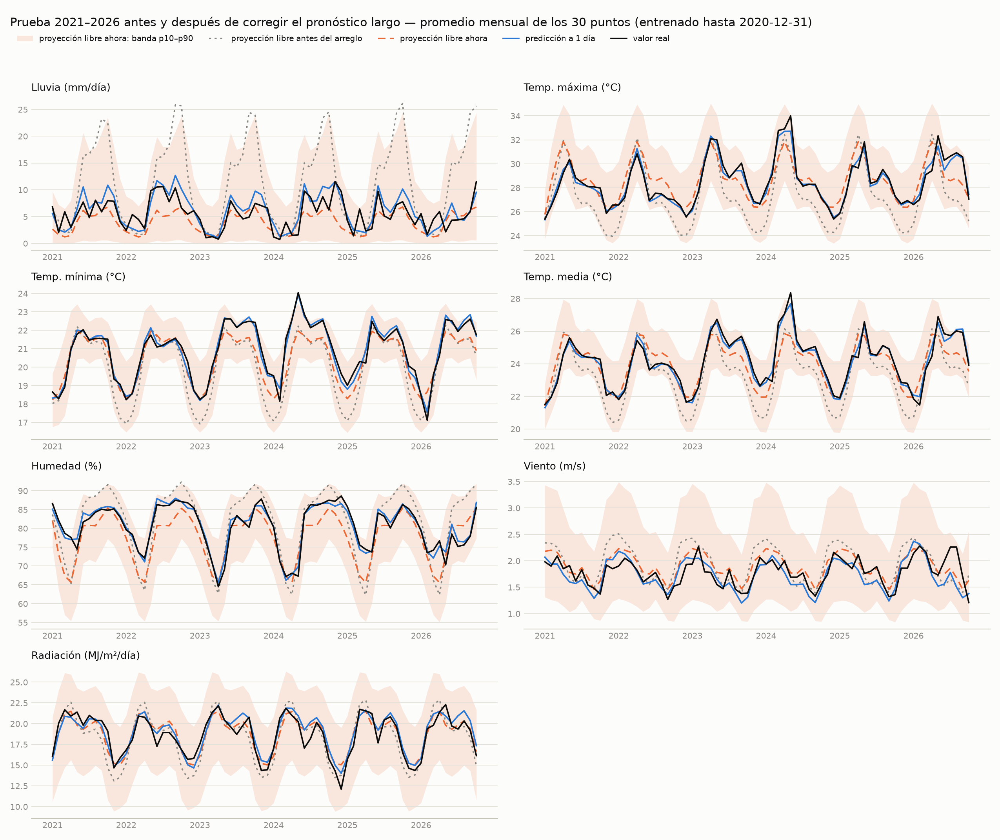

# 01 · Cambios

Lo que se corrigió en Kharis Engine después de la primera corrida con datos reales, con el antes y el después medido. Fecha: 15-11-2026.

La corrida final (v007, datos hasta 2026-11-10) se repitió a las 04:05 con todo esto incluido.

## 1. Deriva del pronóstico largo

**Problema.** La proyección libre de 2021 a 2026, sin ver ningún dato posterior a 2020, se iba alejando del clima real: +5.7 mm/día de lluvia de más y −1.2 °C.

**Dos causas y dos arreglos:**

- **Muestreo.** Al sortear la lluvia desde los cuantiles, la media salía 45% inflada y se realimentaba día tras día. Ahora la muestra conserva la media calibrada. Prueba: `test_muestreo_conserva_la_media`.
- **Ancla.** El modelo, alimentándose de sus propias salidas, se asentaba en un clima propio. Ahora la media del conjunto vuelve a la climatología del punto: enseguida en lluvia y viento, en 7 semanas en el resto. Prueba: `test_pronostico_largo_no_deriva`.

**Resultado** (promedio mensual de los 30 puntos, 2021–2026):

| Variable | Proyección libre antes | Proyección libre ahora | Climatología |
|---|---|---|---|
| Lluvia (mm/día) | 7.38 | 2.57 | 2.57 |
| Temp. máxima (°C) | 1.91 | 1.19 | 1.21 |
| Temp. mínima (°C) | 1.03 | 0.66 | 0.66 |
| Temp. media (°C) | 1.28 | 0.79 | 0.79 |
| Humedad (%) | 5.35 | 4.54 | 4.62 |
| Viento (m/s) | 0.32 | 0.20 | 0.20 |
| Radiación (MJ/m²/día) | 1.30 | 0.96 | 0.96 |

Índice de deriva: **0** (0 de 42 años-variable fuera de tolerancia).

## 2. Dispersión del conjunto (P9 en falso)

**Problema.** Después de corregir la media, la señal P9 "fuera de rango" seguía activa sin motivo en el pronóstico: probabilidad 0.86 en 2026 y 0.70 en 2027. La media estaba bien, pero los miembros del conjunto se separaban entre sí cada vez más.

**Diagnóstico** (365 días desde 2026-11-10, 12 miembros, z = distancia a la climatología en desviaciones típicas):

| Días de adelanto | Dispersión de Tmáx (z) antes | Ahora |
|---|---|---|
| 1–30 | 1.10 | 1.08 |
| 31–90 | 1.18 | 1.01 |
| 91–180 | 1.47 | 1.01 |
| 181–365 | 2.23 | 1.03 |
| Lo observado 2016–2026 | 1.01 | 1.01 |

Antes, 12% de los días-miembro quedaban fuera de rango. En lo observado 2016–2026 hay cerca de 1.5% (0.8% por Tmáx y 0.7% por Tmín). Ahora es 1%.

**Arreglo.** Además de la media, la distancia de cada miembro a la media del conjunto se reescala hasta la desviación típica climatológica del punto, con el mismo peso progresivo del ancla. La lluvia no se reescala: tiene muchos días en cero y ya queda acotada por su media. Código: `_anclar` en `kharis/train_eval.py`. Prueba: la parte nueva de `test_pronostico_largo_no_deriva`.

**Resultado** (media de los 30 puntos):

| Temporada | P9 antes (% días · probabilidad) | P9 ahora |
|---|---|---|
| 2026 (86% ya observado) | 5.7 · 0.86 | 5.5 · 0.79 |
| 2027 (toda pronosticada) | 10.7 · 0.70 | **0.7 · 0.14** |

2026 sigue alto porque 2026 sí tuvo días raros de verdad: en lo observado, P9 vale 6.2 ese año, el más alto de la serie.

Efecto en las bandas: la banda p10–p90 de la proyección libre cubre ahora **77–85%** de los días (nominal 80%). Antes iba de 72% a 87%. El backtesting a 1 y 7 días no cambia: el arreglo solo toca el pronóstico largo.

## 3. Otros arreglos

1. **Margen mínimo para aceptar pesos nuevos (0.2%).** Un empate ya no cambia el modelo.
2. **Lotes cortos.** Antes, si llegaban pocos días, el motor los marcaba como vistos sin aprender de ellos. Ahora se acumulan para la siguiente actualización y el pronóstico igual parte del último día. Prueba: `test_lote_corto_se_acumula`.
3. **Media del conjunto con menos ruido.** Promedia las medias calibradas de los miembros, no sus sorteos.
4. **Bandas p10–p90 entre miembros con posiciones de Weibull.** Con 12–24 miembros la interpolación normal cubría 70% en vez de 80%.
5. **Control de deriva** dentro de la prueba congelada: `datos/deriva_2021_2026.csv`.
6. **Salida web** ligera (`salidas/web/`, 69 KB por punto) y página de ejemplo. Ver [04_GUIA_SITIO.md](04_GUIA_SITIO.md).

## 4. Lo que se probó y se descartó

- **Corregir la deriva con un hindcast** (medirla en 2016–2020 y restarla): empeoró 2021–2026, porque los dos periodos tienen regímenes distintos.
- **Anclar a la anomalía de los últimos 1–5 años:** peor que la climatología fija.
- **Climatología móvil de 10 años:** bajó el error mensual 5–13% en 2021–2026, pero no dentro de 1996–2020. Queda como mejora pendiente, sin activar.

## 5. Verificado con los datos reales

| Qué | Resultado |
|---|---|
| Corrida final (`--export-onnx --tensorboard`) | termina sin errores, v007 activa, unos 7 minutos |
| ONNX contra PyTorch | diferencia máxima 1.2e-06 |
| Prueba congelada 2021–2026 | índice de deriva 0 |
| `--actualizar` con datos nuevos, `--pronosticar`, `--versiones`, `--rollback` | probados en una copia del motor (antes del arreglo de dispersión; ese arreglo no toca este flujo) |
| 38 pruebas | pasan (ver [02_PRUEBAS.md](02_PRUEBAS.md)) |

## 6. Límites que siguen

- **El error diario no puede ser cero.** Lo que quedó en cero es la deriva.
- **La lluvia diaria** a 1 día empata con la climatología y a 7 días es peor. Su valor está en las bandas y en las probabilidades de temporada.
- **A más de dos meses** la media del pronóstico es la climatología del punto.
- **2021–2026 fue más lluvioso y húmedo** que 1996–2020 (+1.6 mm/día, +2.9%). El pronóstico largo hereda esa diferencia.
- **Los dos HTML de Ian** (`html/kharis_real_vs_prediccion_2021_2026.html` y `html/kharis_recalculo_2021_2026_sin_deriva.html`) se hicieron con la corrida anterior al arreglo de dispersión. Medido mes a mes: la predicción a 1 día es idéntica y la proyección libre difiere 0.01 como máximo (0.1 en humedad). Lo único que cambia es la banda p10–p90, que en la corrida final es más ancha: en promedio unos 0.5 °C por lado en Tmáx, 0.3 °C en Tmín y 1.3% en humedad. Los gráficos `grafico_2021_2026_*.html` sí están regenerados con la corrida final.
