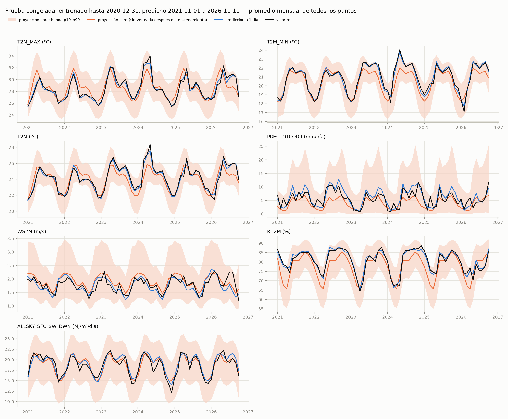

# 03 · Resultados, imágenes y HTML

Corrida final del 15-11-2026 (04:05), con el código definitivo. 30 puntos de Honduras, 1996-01-01 a 2026-11-10. Entrenado con 1996–2020; todo lo de aquí es **fuera de muestra** (2021–2026), salvo donde se indica. El detalle completo está en [`motor/README.md`](motor/README.md), sección 14.

## Cifras clave

**Prueba congelada 2021–2026** (nada posterior a 2020 ajusta nada). Error medio absoluto:

| Variable | A 1 día | Climatología | Mejora | Proyección libre, mensual | Climatología, mensual |
|---|---|---|---|---|---|
| Temp. máxima (°C) | 0.94 | 1.63 | +42% | 1.19 | 1.21 |
| Temp. mínima (°C) | 0.59 | 0.98 | +39% | 0.66 | 0.66 |
| Temp. media (°C) | 0.57 | 1.07 | +47% | 0.79 | 0.79 |
| Humedad (%) | 3.00 | 5.76 | +48% | 4.54 | 4.62 |
| Radiación (MJ/m²/día) | 2.46 | 2.76 | +11% | 0.96 | 0.96 |
| Viento (m/s) | 0.40 | 0.43 | +7% | 0.20 | 0.20 |
| Lluvia (mm/día) | 4.92 | 4.87 | −1% | 2.57 | 2.57 |

- **Índice de deriva: 0** (0 de 42 años-variable fuera de tolerancia).
- **Banda p10–p90** de la proyección libre: cubre 77–85% de los días (nominal 80%).
- **Backtesting walk-forward** (recalibrando cada año) da casi lo mismo a 1 día: Tmáx 0.92, lluvia 4.76. Ver `motor/README.md`.
- **Lluvia diaria:** empata con la climatología a 1 día. Su valor está en las bandas y las probabilidades de temporada.
- **Velocidad:** 5.7 ms por inferencia en GPU; pronóstico de 365 días para los 30 puntos en 56 s.

## Imágenes ([`imagenes/`](imagenes/))

| Archivo | Qué muestra |
|---|---|
| `prueba_2021_2026.png` | La prueba congelada: real, predicción a 1 día y proyección libre con banda, por variable. |
| `comparacion_antes_despues.png` | La proyección libre antes y después de corregir la deriva. |
| `loss_curve.png` | Curvas de pérdida del entrenamiento base. |
| `pred_vs_real.png` | Predicho contra real en validación. |
| `residuals_extremes.png` | Errores en los días extremos. |
| `captura_grafico_recalculo.png` | Captura de `html/grafico_2021_2026_recalculo.html`. |
| `captura_grafico_primera_corrida.png` | Captura de `html/grafico_2021_2026_primera_corrida.html`. |
| `captura_ejemplo_web.png` | Captura de la página de ejemplo con los datos de la corrida final. |
| `captura_kharis_real_vs_prediccion.png` | Captura del HTML de Ian (real contra predicción). |
| `captura_kharis_recalculo_sin_deriva.png` | Captura del HTML de Ian (recálculo sin deriva). |



## HTML ([`html/`](html/))

Todos se abren solos. Los gráficos cargan Chart.js desde un CDN, así que necesitan internet.

| Archivo | Qué es | Datos |
|---|---|---|
| `grafico_2021_2026_recalculo.html` | Real contra predicho 2021–2026 con la proyección libre de ahora y la de antes. | corrida final |
| `grafico_2021_2026_primera_corrida.html` | Lo mismo, como salía antes de corregir la deriva. | primera corrida |
| `kharis_real_vs_prediccion_2021_2026.html` | Gráfico de Ian: real contra predicción. | corrida anterior al arreglo de dispersión* |
| `kharis_recalculo_2021_2026_sin_deriva.html` | Gráfico de Ian: recálculo sin deriva. | corrida anterior al arreglo de dispersión* |
| `ejemplo_web.html` | Página que lee `web/` como lo haría el sitio. | corrida final |

\* Mes a mes, sus líneas coinciden con la corrida final (diferencia máxima 0.01; 0.1 en humedad). Solo la banda p10–p90 es ahora algo más ancha. Ver [01_CAMBIOS.md](01_CAMBIOS.md).

`ejemplo_web.html` pide los JSON con `fetch`, así que no abre con doble clic. Desde esta carpeta:

```bash
python -m http.server 8091 --bind 127.0.0.1
```

y abrir `http://localhost:8091/html/ejemplo_web.html`.

## Datos ([`datos/`](datos/))

| Archivo | Contenido |
|---|---|
| `prueba_2021_2026.csv` | Métricas de la prueba congelada por modo (1 día, 7 días, libre diario, libre mensual), variable y año. |
| `deriva_2021_2026.csv` | Deriva de la proyección libre por variable y año, con su tolerancia. |
| `metrics_summary.json` / `.csv` | Todas las métricas de la corrida: validación, backtesting antes y después, estrés. |
| `registro_versiones.json` | Las versiones v001–v007 del modelo, con fechas, motivos, deriva y poda. |
| `senales_p1_p10.csv` | Señales P1–P10 del pronóstico actual, por punto y temporada. |
| `busqueda_gpu.json` | La búsqueda de configuración en la GPU (lote, precisión, tamaño de red). |
