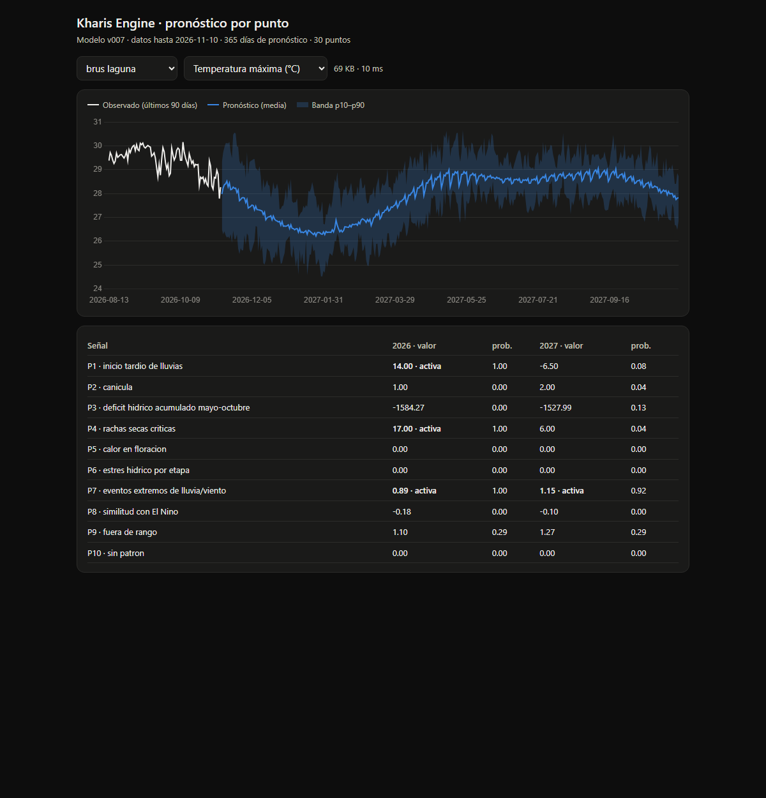

# 04 · Guía para conectar el sitio

Cómo llevar el pronóstico de Kharis al sitio de `agroresilience/frontend/` (Vite + React + TypeScript, en Vercel). Está pensada para hacerlo en otra sesión, sin tener que releer el motor.

## La idea

El sitio **no corre el modelo**. El motor calcula todo cuando llegan datos y deja un JSON pequeño por punto. El sitio solo lo descarga y lo dibuja, como una app del clima.

- `indice.json`: 5 KB, la lista de puntos.
- `<punto>.json`: 69 KB (unos 21 KB con gzip). 90 días observados, 365 de pronóstico, física y señales.

Hay copia de los 31 archivos en [`web/`](web/), y una página completa que los lee en [`html/ejemplo_web.html`](html/ejemplo_web.html).



## Paso 1. Copiar los archivos

1. Crear `frontend/public/kharis/` (hoy `frontend/` no tiene carpeta `public/`).
2. Copiar ahí todo `kharis_engine/salidas/web/`.

Vite sirve `public/` tal cual en `/kharis/...`. En Vercel, los archivos estáticos ganan a la regla `rewrites` de `vercel.json`, así que `/kharis/indice.json` llega bien.

**Ojo:** si se pide un archivo que no existe, esa misma regla devuelve `index.html` con código 200. Al leer, hay que comprobar que la respuesta es JSON (ver el paso 3).

## Paso 2. Tipos

Copiados de los archivos reales (contrato `kharis.web.v1`):

```ts
export type Variable = 'T2M_MAX' | 'T2M_MIN' | 'T2M' | 'PRECTOTCORR' | 'WS2M' | 'RH2M' | 'ALLSKY_SFC_SW_DWN'
export type Patron = 'P1' | 'P2' | 'P3' | 'P4' | 'P5' | 'P6' | 'P7' | 'P8' | 'P9' | 'P10'
type Serie = (number | null)[]   // null = sin dato

export interface IndiceKharis {
  contrato: 'kharis.web.v1'
  motor: string
  generado: string               // "2026-11-15T04:12:..."
  version_modelo: string         // "v007"
  fecha_base: string             // último día observado, "2026-11-10"
  dias_pronostico: number        // 365
  dias_historia: number          // 90
  miembros: number               // 24
  objetivos: Variable[]
  unidades: Record<Variable, string>
  fisica: string[]
  patrones: Record<Patron, string>
  cultivo: string                // "maiz"
  ciclo: string                  // "primera"
  nota: string
  puntos: { punto: string; lat: number; lon: number; elevacion: number; archivo: string; kb: number }[]
}

export interface Senal { valor: number | null; percentil: number | null; probabilidad: number; activo: boolean }

export interface PuntoKharis {
  punto: string
  lat: number
  lon: number
  elevacion: number
  historia: { inicio: string } & Record<Variable, Serie>                          // 90 días
  pronostico: { inicio: string; dias: number } & Record<Variable, { media: Serie; p10: Serie; p90: Serie }>
  fisica: {
    et0: Serie; etc: Serie; reserva: Serie; reserva_p10: Serie; reserva_p90: Serie; deficit: Serie; ks: Serie
    gdd_acum: Serie; dias_secos_consec: Serie
    prob_lluvia_intensa: Serie; prob_dia_seco: Serie; prob_dia_calor: Serie; prob_dia_calor_floracion: Serie
  }
  senales: ({ temporada: number; fraccion_pronosticada: number } & Record<Patron, Senal>)[]
}
```

**Huecos:** `null` aparece de verdad. Hoy los 30 puntos tienen un día sin radiación en `historia.ALLSKY_SFC_SW_DWN` (posición 25). El gráfico debe cortar la línea o saltar ese día, no dibujar un cero.

**Fechas:** cada serie es diaria. El valor `k` es el día `inicio + k`. `historia.inicio` y `pronostico.inicio` son distintos: el pronóstico empieza el día después de `fecha_base`.

```ts
const fecha = (inicio: string, k: number) => {
  const d = new Date(inicio + 'T00:00:00Z')
  d.setUTCDate(d.getUTCDate() + k)
  return d.toISOString().slice(0, 10)
}
```

## Paso 3. Leer

```ts
const BASE = '/kharis/'

async function leerJson<T>(ruta: string): Promise<T> {
  const r = await fetch(BASE + ruta)
  if (!r.ok || !(r.headers.get('content-type') ?? '').includes('json')) throw new Error('Kharis: falta ' + ruta)
  return r.json() as Promise<T>
}

const indice = await leerJson<IndiceKharis>('indice.json')
const punto = await leerJson<PuntoKharis>(indice.puntos.find((p) => p.punto === 'tegucigalpa')!.archivo)
```

Para que se sienta instantáneo:

1. Cargar el índice al abrir y **un solo punto** cuando se elige. No descargar los 30.
2. Guardar en memoria los puntos ya pedidos (un `Map` basta).
3. Precargar el punto probable (el último visto o la zona activa).
4. Vercel ya comprime con gzip/brotli. Caché sugerida: `indice.json` 5 minutos, los puntos 1 hora. Los archivos solo cambian cuando se corre el motor.

## Paso 4. Unir con las zonas del sitio

El sitio tiene 11 zonas en `src/datos/zonas.generado.json`. Kharis tiene 30 puntos. Nueve usan el mismo id; dos no:

| Zona del sitio | Punto de Kharis | Coordenadas |
|---|---|---|
| `san_pedro_sula` | `sula` | 15.50, −88.03 (iguales) |
| `santa_rosa_copan` | `santa_rosa` | 14.77, −88.78 (iguales) |

Las otras nueve coinciden: `choluteca`, `nacaome`, `tegucigalpa`, `comayagua`, `danli`, `juticalpa`, `catacamas`, `la_esperanza`, `yoro`. Basta un mapa pequeño de alias. Los otros 19 puntos de Kharis no tienen zona en el sitio todavía.

## Paso 5. Qué mostrar y cómo leerlo

| Dato | Cómo presentarlo | Cuidado |
|---|---|---|
| `pronostico.<var>.media` | Línea | A más de dos meses es la climatología del punto. No sirve para "qué día llueve". |
| `p10` y `p90` | Banda | Cubre cerca de 80% de los días (77–85% medido). |
| `PRECTOTCORR` | Mejor como probabilidad o acumulado semanal o mensual | La lluvia de un día exacto no se puede anticipar: a 1 día empata con la climatología. |
| `fisica.reserva` | Agua en el suelo (mm), con banda | Sigue desde lo observado; no se reinicia. |
| `fisica.prob_*` | Probabilidad diaria (0–1) | — |
| `senales[i].Px` | Tarjetas por temporada | Ver abajo. |

**Señales:**

- `senales` trae una fila por temporada (hoy 2026 y 2027).
- `fraccion_pronosticada` dice cuánto es pronóstico: 2026 es 0.14 (casi todo ya observado), 2027 es 1.0 (todo pronóstico). Conviene mostrarlo, por ejemplo "basado en 86% de datos reales".
- `probabilidad` es la fracción de miembros del conjunto que activan la señal. `activo` es `true` cuando esa fracción llega a 0.5.
- `percentil` compara con la historia del punto en 1996–2020. Puede ser `null` (P10 siempre lo es).
- Las descripciones de cada señal están en `indice.patrones`.

## Paso 6. Actualizar

Cuando haya datos nuevos en `processed/`, desde `kharis_engine/`:

```bash
..\.venv_kharis\Scripts\python.exe run_kharis.py --actualizar
```

Luego copiar otra vez `salidas/web/` a `frontend/public/kharis/` y publicar. Sin datos nuevos, `--pronosticar` regenera lo mismo. Detalle en [05_IMPLEMENTACION.md](05_IMPLEMENTACION.md).

## Fase siguiente: propuestas

Las recomendaciones (Gemini Decision u otra) deben calcularse **una vez por punto** cuando cambian los datos y guardarse junto al JSON. La página solo las lee. Llamar a un modelo de lenguaje en cada visita la haría lenta y cara. La entrada natural son las señales P1–P10 y `datos/senales_p1_p10.csv`.

## Si hiciera falta inferir en vivo

`kharis_engine/artefactos/kharis_engine.onnx` (1.5 MB) corre con `onnxruntime-web`. Entradas `clima_ventana [lote, 64, 44]` y `climatologia_futura [lote, 7, 7]`; salidas `prediccion` y `cuantiles` a 7 días. Pero preparar esas entradas requiere el mismo escalado del motor. Para el sitio normal, la salida ya calculada es mejor.

## Sin probar

- La carga desde Vercel: solo se midió en local (5–10 ms por punto).
- La integración en el sitio real: esta guía la describe, no está hecha.
